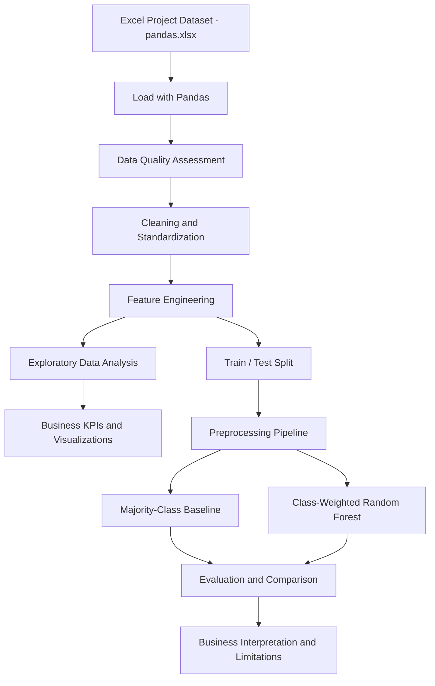

<div align="center">

# Retail Sales Analytics & Predictive Modeling

**An end-to-end retail data project combining Data Analytics, Exploratory Data Analysis, and imbalanced binary classification.**

[](https://www.python.org/)
[](https://pandas.pydata.org/)
[](https://scikit-learn.org/)
[](https://jupyter.org/)
[]()

</div>

---

## Table of Contents

- [Project Overview](#project-overview)
- [Project Objectives](#project-objectives)
- [Business Questions](#business-questions)
- [Architecture and Workflow](#architecture-and-workflow)
- [Repository Structure](#repository-structure)
- [Dataset](#dataset)
- [Data Dictionary](#data-dictionary)
- [Technologies](#technologies)
- [Installation and Usage](#installation-and-usage)
- [Analytics and Visualizations](#analytics-and-visualizations)
- [Predictive Modeling](#predictive-modeling)
- [Evaluation Strategy](#evaluation-strategy)
- [Key Findings](#key-findings)
- [Limitations and Future Improvements](#limitations-and-future-improvements)

## Project Overview

This project analyzes retail transaction data to understand sales performance, customer and product patterns, sales-channel activity, order status, and geographic distribution. It also explores a supervised machine-learning task: classifying transactions as **B2B or B2C**.

The project is deliberately presented as both:

- **Data Analytics:** data quality assessment, cleaning, feature engineering, KPI analysis, exploratory analysis, and business-oriented visualizations.
- **Data Science:** preprocessing pipelines, baseline modeling, Random Forest classification, and evaluation designed for an imbalanced target.

> **Dataset note:** The repository is intended to include the Excel file named **`Excel Project Dataset - pandas.xlsx`**. Place it in the repository root next to the notebook. The original uploaded notebook referenced a different filename, so the revised notebook has been updated to use the requested repository filename.

## Project Objectives

### Data Analytics
- Inspect the dataset structure, data types, missing values, and duplicate records.
- Standardize column names and correct inconsistent quantity representations.
- Engineer date and age-group features for descriptive analysis.
- Analyze sales by month, gender, category, channel, order status, and shipping state.
- Extract evidence-based business observations from the results.

### Data Science
- Define B2B classification as an exploratory binary prediction task.
- Establish a majority-class baseline.
- Build a preprocessing and modeling pipeline to avoid fitting transformations on test data.
- Train a class-weighted Random Forest.
- Evaluate minority-class performance using precision, recall, F1-score, balanced accuracy, and average precision.

## Business Questions

1. How does recorded sales amount change over time?
2. Which product categories and sales channels account for the largest sales amounts or order-line volumes?
3. How are orders distributed across customer age groups and gender?
4. Which shipping states contribute the most recorded sales?
5. What is the distribution of order statuses?
6. Can transaction attributes help distinguish B2B from B2C records, and how reliable is that prediction for the minority class?

## Architecture and Workflow



## Repository Structure

```text
retail-sales-analytics/
│
├── data/
│   └── README.md                         # Optional data storage notes
│
├── Excel Project Dataset - pandas.xlsx   # Source Excel dataset
├── Retail_Sales_Analytics_and_B2B_Classification.ipynb
├── requirements.txt
└── README.md
```

The notebook currently expects the Excel workbook in the **repository root**. If you prefer to store it under `data/`, update `DATA_PATH` in the notebook accordingly.

## Dataset

**File:** `Excel Project Dataset - pandas.xlsx`  
**Format:** Excel workbook (`.xlsx`)  
**Role:** Source data for the cleaning, analysis, visualizations, and classification workflow.

The original notebook output showed fields commonly found in retail order exports, including order/customer identifiers, customer attributes, date, status, product category, size, quantity, amount, shipping geography, B2B flag, and sales channel.

The exact schema, row count, date coverage, currency, and business definitions must be confirmed against the Excel file committed to the repository. Do not publish assumed dataset statistics as facts.

### Data Dictionary

The table below is based on the columns visible in the original notebook. Confirm each definition against the workbook before treating it as authoritative.

| Column | Description | Typical analytical use |
|---|---|---|
| `Order ID` | Identifier associated with an order | Distinct-order counts; excluded from model features |
| `Cust ID` | Customer identifier | Customer counts; excluded from model features |
| `Gender` | Customer gender category as recorded in source | Descriptive segmentation |
| `Age` | Customer age | Age distribution and age bands |
| `Date` | Order or transaction date | Monthly and weekday trends |
| `Status` | Recorded order status | Order-status analysis |
| `Category` | Product category | Category performance |
| `Size` | Product size | Product mix analysis |
| `Qty` / `Quantity` | Quantity recorded for the row | Unit-volume analysis |
| `Amount` | Monetary amount recorded in the source | Sales analysis; confirm its precise definition |
| `Channel` | Sales platform or channel | Channel performance |
| `ship-city` | Shipping city | Geographic analysis |
| `ship-state` | Shipping state | Geographic analysis |
| `ship-postal-code` | Shipping postal code | Potentially high-cardinality location field |
| `ship-country` | Shipping country | Geographic context |
| `currency` | Currency code | Monetary interpretation |
| `B2B` | Business-to-business indicator | Classification target |
| `SKU` | Product stock-keeping identifier | Product-level analysis; excluded from the baseline model |
| `index` | Source/export row index | Usually not analytically useful |

## Technologies

| Technology | Purpose |
|---|---|
| Python | Main programming language |
| Pandas | Data loading, cleaning, transformation, and aggregation |
| NumPy | Numerical operations |
| Matplotlib | Data visualization |
| Seaborn | Statistical visualization styling |
| Scikit-learn | Preprocessing, baseline, Random Forest, and evaluation |
| Jupyter Notebook | Reproducible analysis and documentation |
| Excel | Source dataset format |

## Installation and Usage

### 1. Clone the repository

```bash
git clone https://github.com/<your-username>/<your-repository>.git
cd <your-repository>
```

### 2. Create and activate a virtual environment

```bash
python -m venv .venv
```

Windows:

```bash
.venv\Scripts\activate
```

macOS / Linux:

```bash
source .venv/bin/activate
```

### 3. Install dependencies

```bash
pip install -r requirements.txt
```

### 4. Add the Excel dataset

Place `Excel Project Dataset - pandas.xlsx` in the repository root.

### 5. Launch Jupyter

```bash
jupyter notebook
```

Open `Retail_Sales_Analytics_and_B2B_Classification.ipynb` and run the notebook from top to bottom.

## Analytics and Visualizations

The notebook includes:

- Data-quality summary: dimensions, data types, missing values, and exact duplicate rows.
- Sales KPIs: total recorded amount, average and median row amount, unique orders/customers, and total quantity where available.
- Monthly sales trend.
- Sales amount by gender.
- Order-line volume by sales channel.
- Sales by product category.
- Order-status distribution.
- Top shipping states by recorded sales amount.
- Order-line distribution by age group and gender.

**Interpretation requirement:** charts should be accompanied by specific observations derived from the actual run. The README intentionally does not invent findings or numerical results.

## Predictive Modeling

### Problem definition

- **Task:** Binary classification
- **Target:** `B2B`
- **Classes:** B2C (`0`) and B2B (`1`), after target normalization
- **Baseline:** `DummyClassifier(strategy="most_frequent")`
- **Model:** Random Forest with `class_weight="balanced_subsample"`

### Modeling workflow

1. Separate the target from explanatory variables.
2. Exclude identifiers and fields unsuitable for generalization, such as order/customer IDs and postal code.
3. Split the data into training and test sets using stratification.
4. Impute missing numerical and categorical values inside a Scikit-learn pipeline.
5. One-hot encode categorical features with unknown-category handling.
6. Train a class-weighted Random Forest.
7. Compare its performance against the majority-class baseline.

### Important prediction-time consideration

The feature set must reflect when the prediction would be made. For example, `Status` may be determined after an order is placed. If the intended use is to classify an order at checkout, remove any feature that is not available at checkout. Feature availability and target definition should be documented before making business claims.

## Evaluation Strategy

The original notebook reported approximately **99.29% accuracy**, but the original target distribution contained **30,861 non-B2B records and 186 B2B records**. Under this imbalance, a model can obtain high accuracy while failing to identify B2B records.

The revised notebook therefore reports:

| Metric | Why it matters |
|---|---|
| Precision | How many predicted B2B records are actually B2B |
| Recall | How many actual B2B records are identified |
| F1-score | Balance between precision and recall |
| Balanced accuracy | Average recall across classes |
| Average precision (PR-AUC) | Useful summary for minority-class retrieval |
| Confusion matrix | Shows correct and incorrect predictions per class |

A model should not be described as successful unless it improves meaningfully over the baseline on metrics aligned with the business objective.

## Key Findings

Add your verified findings here after running the notebook. Recommended format:

- **Finding 1 — Sales trend:** State the strongest observed monthly pattern and the values supporting it.
- **Finding 2 — Product mix:** Identify the leading categories using actual aggregated sales.
- **Finding 3 — Channel performance:** Compare channels using clearly defined measures.
- **Finding 4 — Geography:** Report the highest-contributing states and their sales amounts.
- **Finding 5 — Model performance:** Report minority-class precision, recall, F1, and average precision against the baseline.

## Limitations and Future Improvements

- Confirm whether each row represents an order or an order line before interpreting row counts as orders.
- Validate the meaning of `Amount`, its currency, and whether it is gross, net, or item-level value.
- Investigate repeated order IDs instead of dropping them automatically.
- Review missing values and unusual numeric values with domain context.
- Remove post-outcome features if predicting at an earlier point in the order lifecycle.
- Use time-based validation when the intended application is prediction on future transactions.
- Tune classification thresholds against a clearly stated business objective.
- Add feature-importance analysis or SHAP after validating the modeling setup.
- Build a Power BI dashboard for stakeholder-facing reporting.

---

<div align="center">

**Built as a portfolio project demonstrating Data Analytics and applied Data Science skills.**

</div>
